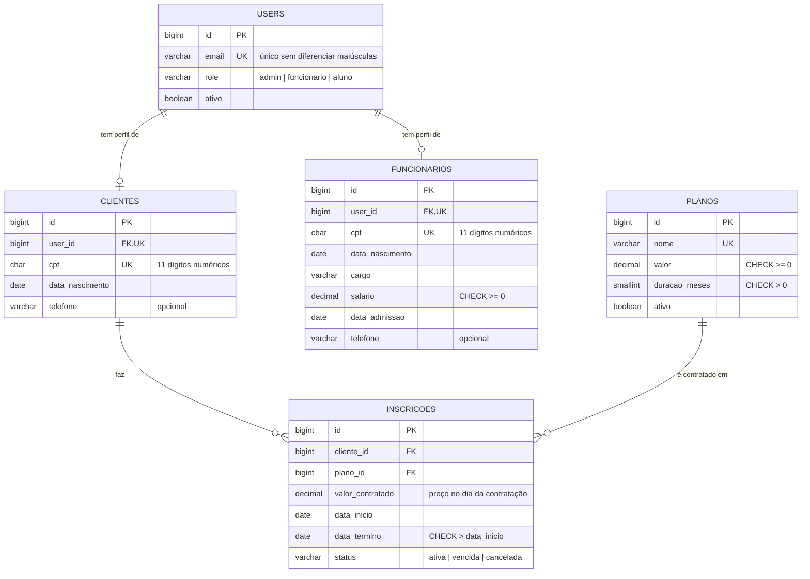

# Modelo de Dados — FitnessFusion

## 1. Visão Geral

Este documento descreve a modelagem relacional do banco de dados da aplicação **FitnessFusion**, implementado em **PostgreSQL 17** e gerenciado via migrations do **Laravel**. O banco centraliza a autenticação e o controle de acesso (RBAC), o catálogo de planos de assinatura, os perfis cadastrais de alunos e funcionários e o histórico financeiro de inscrições da academia.

---

## 2. Diagrama Entidade-Relacionamento

---

## 3. Convenções

* **Escopo do Dicionário:** As regras abaixo aplicam-se às tabelas de domínio do negócio. Tabelas internas de infraestrutura do Laravel (`cache`, `jobs`, `sessions`, `password_reset_tokens`) seguem o padrão do framework e ficam fora do dicionário principal.
* **Nomenclatura:** Nomes em português, formato `snake_case`, com tabelas no plural (`clientes`, `planos`) e chaves estrangeiras no singular (`user_id`, `plano_id`).
* **Identificadores e Auditoria:** Todas as tabelas de domínio possuem chave primária `id` (`bigint` auto-incremental) e colunas de auditoria `created_at` e `updated_at`.
* **Valores Monetários:** Sempre armazenados como `decimal(10, 2)` (`NUMERIC` no PostgreSQL), nunca `float`, evitando erros de arredondamento binário em centavos.
* **Integridade Referencial e Desativação:** Chaves estrangeiras utilizam `ON DELETE RESTRICT` e índices B-Tree explícitos. Registros com histórico não são excluídos fisicamente: pessoas são desativadas por `users.ativo = false`, planos por `planos.ativo = false` e inscrições encerradas recebem `status = 'cancelada'`.
* **Defesa em Profundidade:** Regras críticas de domínio são validadas na aplicação (Laravel `FormRequest`) e reforçadas diretamente no motor do banco via `CHECK` constraints e índices parciais.

---

## 4. Dicionário de Dados

### `users`
Tabela central de autenticação e autorização (RBAC) do sistema.

| Coluna | Tipo | Nulo | Regras / Restrições | Descrição |
| :--- | :--- | :--- | :--- | :--- |
| `id` | `bigint` | Não | PK | Identificador único do usuário. |
| `name` | `varchar(100)` | Não | — | Nome completo exibido na interface. |
| `email` | `varchar(150)` | Não | Índice único (`lower(email)`) | Credencial de login; impede duplicidade independente de maiúsculas/minúsculas. |
| `email_verified_at` | `timestamp` | Sim | — | Data/hora de confirmação do e-mail. |
| `password` | `varchar(255)` | Não | — | Hash criptográfico da senha (Bcrypt). |
| `role` | `varchar(255)` | Não | CHECK (`admin`, `funcionario`, `aluno`), padrão `aluno` | Perfil de acesso que define as permissões no painel administrativo. |
| `ativo` | `boolean` | Não | Padrão `true` | Define se o usuário pode autenticar; bloqueia acesso sem apagar histórico. |
| `remember_token` | `varchar(100)` | Sim | — | Token para sessões persistentes. |
| `created_at` / `updated_at` | `timestamp` | Sim | — | Carimbos de data/hora de criação e última atualização. |

### `planos`
Catálogo de planos de assinatura comercializados pela academia.

| Coluna | Tipo | Nulo | Regras / Restrições | Descrição |
| :--- | :--- | :--- | :--- | :--- |
| `id` | `bigint` | Não | PK | Identificador único do plano. |
| `nome` | `varchar(50)` | Não | Único | Nome comercial exibido no site (ex.: "Mensal", "Anual"). |
| `valor` | `decimal(10, 2)` | Não | CHECK (`valor >= 0`) | Preço **atual** de tabela do plano. |
| `duracao_meses` | `smallint` | Não | CHECK (`duracao_meses > 0`) | Duração em meses; usada para calcular `data_termino` na inscrição. |
| `descricao` | `text` | Sim | — | Detalhamento dos benefícios incluídos no plano. |
| `ativo` | `boolean` | Não | Padrão `true` | Plano desativado não aparece para novas vendas, mas preserva o histórico das inscrições antigas. |
| `created_at` / `updated_at` | `timestamp` | Sim | — | Carimbos de data/hora de criação e última atualização. |

### `clientes`
Dados específicos dos usuários com perfil de aluno matriculado.

| Coluna | Tipo | Nulo | Regras / Restrições | Descrição |
| :--- | :--- | :--- | :--- | :--- |
| `id` | `bigint` | Não | PK | Identificador único do aluno. |
| `user_id` | `bigint` | Não | FK (`users.id`), único, `RESTRICT` | Liga o perfil de aluno à sua conta de login (relação 1:1). |
| `cpf` | `char(11)` | Não | Único, CHECK (11 dígitos numéricos) | Documento fiscal armazenado apenas com os 11 dígitos numéricos. |
| `data_nascimento` | `date` | Não | — | Identificação do aluno e cálculo de faixa etária para organização dos treinos. |
| `telefone` | `varchar(20)` | Sim | CHECK (não vazio) | Telefone de contato; não é único para permitir responsáveis de menores. |
| `created_at` / `updated_at` | `timestamp` | Sim | — | Carimbos de data/hora de criação e última atualização. |

### `funcionarios`
Dados administrativos e trabalhistas da equipe da academia.

| Coluna | Tipo | Nulo | Regras / Restrições | Descrição |
| :--- | :--- | :--- | :--- | :--- |
| `id` | `bigint` | Não | PK | Identificador único do funcionário. |
| `user_id` | `bigint` | Não | FK (`users.id`), único, `RESTRICT` | Liga o perfil profissional à conta de login em `users` (relação 1:1). |
| `cpf` | `char(11)` | Não | Único, CHECK (11 dígitos numéricos) | Documento fiscal armazenado apenas com os 11 dígitos numéricos. |
| `data_nascimento` | `date` | Não | — | Data de nascimento do colaborador. |
| `telefone` | `varchar(20)` | Sim | CHECK (não vazio) | Telefone de contato corporativo ou pessoal. |
| `cargo` | `varchar(50)` | Não | — | Função exercida na academia (ex.: "Instrutor", "Recepcionista", "Gerente"). |
| `salario` | `decimal(10, 2)` | Não | CHECK (`salario >= 0`) | Remuneração mensal contratada. |
| `data_admissao` | `date` | Não | — | Data oficial de início do vínculo empregatício. |
| `created_at` / `updated_at` | `timestamp` | Sim | — | Carimbos de data/hora de criação e última atualização. |

### `inscricoes`
Registro financeiro e contratual que vincula um aluno a um plano por um período determinado.

| Coluna | Tipo | Nulo | Regras / Restrições | Descrição |
| :--- | :--- | :--- | :--- | :--- |
| `id` | `bigint` | Não | PK | Identificador único da inscrição. |
| `cliente_id` | `bigint` | Não | FK (`clientes.id`), índice, `RESTRICT` | Aluno titular da assinatura. |
| `plano_id` | `bigint` | Não | FK (`planos.id`), índice, `RESTRICT` | Plano contratado no ato da matrícula. |
| `valor_contratado` | `decimal(10, 2)` | Não | CHECK (`valor_contratado >= 0`) | Fotografia do valor pago no dia da contratação (imune a reajustes futuros do plano). |
| `data_inicio` | `date` | Não | — | Data de início da vigência do contrato. |
| `data_termino` | `date` | Não | CHECK (`data_termino > data_inicio`) | Data de encerramento da vigência do contrato. |
| `status` | `varchar(255)` | Não | CHECK (`ativa`, `vencida`, `cancelada`), índice único parcial (`WHERE status = 'ativa'`) | Situação atual da inscrição; impede mais de uma assinatura ativa simultânea por cliente. |
| `created_at` / `updated_at` | `timestamp` | Sim | — | Carimbos de data/hora de criação e última atualização. |

---

## 5. Dados Sensíveis e Privacidade (LGPD)

Mapeamento dos dados pessoais armazenados no banco conforme os princípios de minimização e segurança da Lei Geral de Proteção de Dados (Lei nº 13.709/2018):

| Dado | Tabela / Coluna | Classificação | Proteção | Status |
| :--- | :--- | :--- | :--- | :--- |
| **Senha** | `users.password` | Credencial crítica | Hash criptográfico unidirecional (Bcrypt) e ocultação na serialização do Model (`$hidden`). | ✅ Implementado |
| **Nome e E-mail** | `users.name`, `users.email` | Dado pessoal | Índice único case-insensitive; acesso autenticado e restrito ao próprio titular ou equipe autorizada via Policies. | 🔜 Fase 2 |
| **CPF** | `clientes.cpf`, `funcionarios.cpf` | Dado pessoal identificável | Formato numérico garantido por `CHECK` no banco (`✅`). Controle de acesso via Policies, mascaramento em listagens e sanitização de logs de erro (`🔜`). | 🟡 Parcial |
| **Data de Nascimento** | `clientes.data_nascimento`, `funcionarios.data_nascimento` | Dado pessoal | Visível apenas ao próprio titular e à equipe administrativa autorizada via Policies. | 🔜 Fase 2 |
| **Salário** | `funcionarios.salario` | Dado pessoal / confidencial | Restrito exclusivamente ao perfil `admin` via Policies; oculto para `funcionario` comum e `aluno`. | 🔜 Fase 2 |
| **Telefone** | `clientes.telefone`, `funcionarios.telefone` | Dado pessoal de contato | Coleta opcional (`nullable`) com minimização aplicada (endereço residencial descartado por falta de requisito). Proteção de rota via Policies (`🔜`). | 🔜 Fase 2 |
| **IP e User-Agent** | `sessions.ip_address`, `sessions.user_agent` | Dado pessoal (identificador digital) | Tabela nativa de sessões do Laravel; acesso restrito ao banco e limpeza periódica de sessões expiradas. | 🔜 Fase 2 |

> **Nota de evolução:** Quando o módulo de **Avaliação Física** for adicionado nas fases seguintes, os registros biométricos (peso, altura, medidas corporais) entrarão neste mapa como **dados pessoais sensíveis referentes à saúde** (Art. 11 da LGPD), exigindo consentimento explícito e controle estrito de acesso.

---

## 6. Decisões de Modelagem

### 1. Coluna `valor_contratado` em `inscricoes`
* **Decisão:** Armazenar o valor pago no momento da contratação dentro da tabela `inscricoes`, separado de `planos.valor`.
* **Por quê:** O preço de tabela de um plano sofre reajustes ao longo do tempo, mas o contrato já firmado com o aluno mantém o valor acordado no dia da matrícula. Sem essa coluna, qualquer reajuste alteraria retroativamente o histórico financeiro da academia.
* **Alternativa descartada:** Consultar o preço dinamicamente via `JOIN` com a tabela `planos`.

### 2. Separação entre credenciais (`users`) e perfis (`clientes` / `funcionarios`)
* **Decisão:** Centralizar e-mail, senha e status de acesso em `users`, mantendo tabelas separadas para os atributos específicos de cada papel.
* **Por quê:** Garante um único ponto de autenticação e hashing de senha, reduz a superfície de ataque e evita duplicidade de credenciais no banco.
* **Alternativa descartada:** Manter colunas de e-mail e senha duplicadas dentro de `clientes` e `funcionarios` (como no sistema legado).

### 3. Fonte única da verdade para status de acesso (`users.ativo`)
* **Decisão:** Manter a flag booleana `ativo` apenas em `users` (e `planos`), removendo-a de `funcionarios`.
* **Por quê:** Evita estados inconsistentes (ex.: funcionário marcado como inativo em `funcionarios`, mas ainda capaz de logar por estar `ativo = true` em `users`).
* **Alternativa descartada:** Manter flags `ativo` independentes em `users` e `funcionarios`.

### 4. Índice único parcial para inscrição ativa (`WHERE status = 'ativa'`)
* **Decisão:** Criar um índice único condicional no PostgreSQL sobre `inscricoes(cliente_id)` filtrado apenas para registros com `status = 'ativa'`.
* **Por quê:** Impede que um aluno tenha duas assinaturas vigentes ao mesmo tempo mesmo em cenários de concorrência (*race condition* com duas requisições simultâneas), enquanto permite manter um histórico ilimitado de inscrições `vencida` ou `cancelada`.
* **Alternativa descartada:** Validar a unicidade apenas via consulta `SELECT` no PHP antes do `INSERT` (vulnerável a requisições paralelas).

### 5. Papel de acesso (`users.role`) vs. perfil de treino (`clientes`)
* **Decisão:** O campo `users.role` (`admin`, `funcionario`, `aluno`) define exclusivamente o nível de permissão administrativa no sistema, enquanto "ser aluno" significa possuir um registro vinculado na tabela `clientes`.
* **Por quê:** Permite que um instrutor ou recepcionista (`role = 'funcionario'`) também treine na academia e tenha um vínculo em `clientes` e `inscricoes`, sem precisar de duas contas de login diferentes. Nas Policies de autorização (Fase 2), o acesso aos dados de treino e inscrição verifica a existência do vínculo `user->cliente`, independentemente de a `role` ser `aluno` ou `funcionario`.
* **Alternativa descartada:** Transformar `role` em uma tabela N:N de múltiplos papéis ou impedir que funcionários se matriculem como alunos.