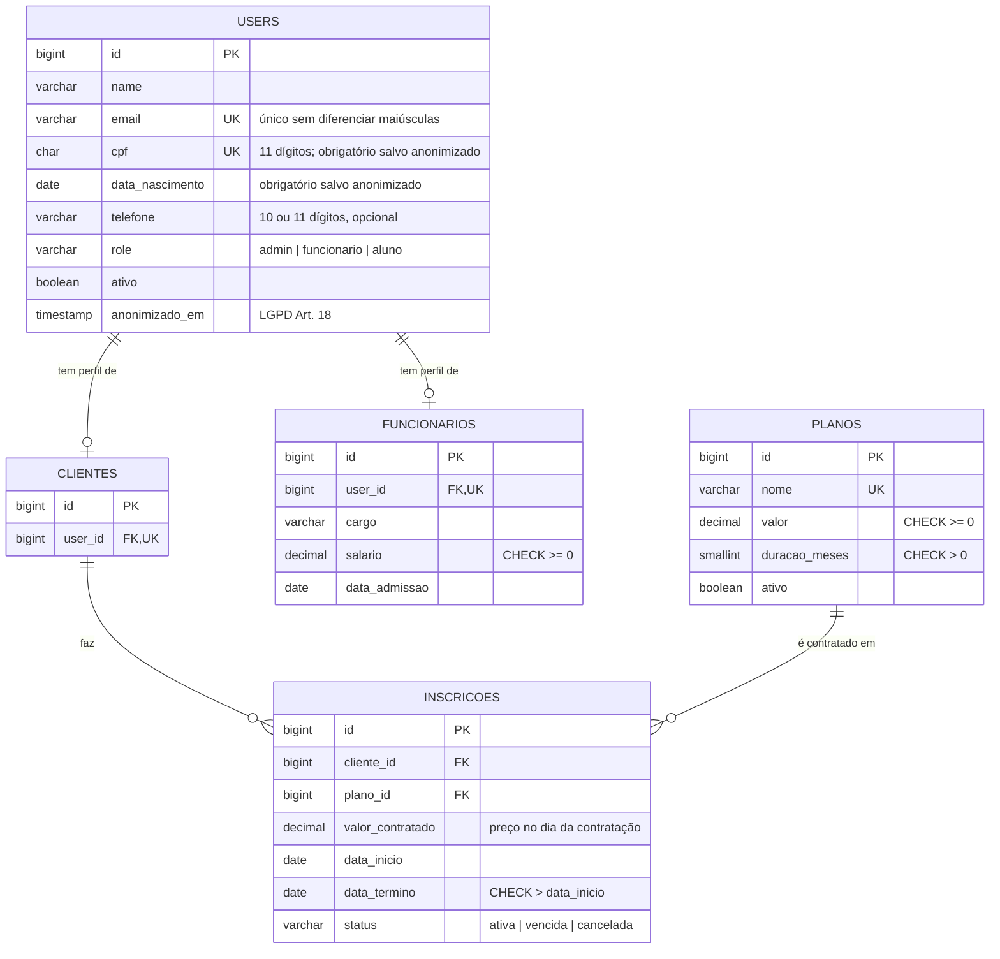

# Modelo de Dados — FitnessFusion

## 1. Visão Geral

Este documento descreve a modelagem relacional do banco de dados da aplicação **FitnessFusion**, implementado em **PostgreSQL 17** e gerenciado via migrations do **Laravel**. O banco centraliza a identidade das pessoas (dados civis e credenciais), o controle de acesso (RBAC), o catálogo de planos de assinatura, os perfis de alunos e funcionários e o histórico financeiro de inscrições da academia.

---

## 2. Diagrama Entidade-Relacionamento

---

## 3. Convenções

* **Escopo do Dicionário:** As regras abaixo aplicam-se às tabelas de domínio do negócio. Tabelas internas de infraestrutura do Laravel (`cache`, `jobs`, `sessions`, `password_reset_tokens`) seguem o padrão do framework e ficam fora do dicionário principal.
* **Nomenclatura:** Nomes em português, formato `snake_case`, com tabelas no plural (`clientes`, `planos`) e chaves estrangeiras no singular (`user_id`, `plano_id`).
* **Identificadores e Auditoria:** Todas as tabelas de domínio possuem chave primária `id` (`bigint` auto-incremental) e colunas de auditoria `created_at` e `updated_at`.
* **Valores Monetários:** Sempre armazenados como `decimal(10, 2)` (`NUMERIC` no PostgreSQL), nunca `float`, evitando erros de arredondamento binário em centavos.
* **Documentos e Contatos:** CPF (11 dígitos) e telefone (10 ou 11 dígitos, com DDD) armazenados apenas com números, sem pontuação, garantidos por `CHECK`; a formatação é responsabilidade da camada de exibição.
* **Dados da pessoa vs. dados do papel:** Dados civis (CPF, nascimento, telefone) pertencem à pessoa e ficam em `users`; tabelas de perfil (`clientes`, `funcionarios`) guardam apenas o que é específico do papel.
* **Integridade Referencial e Desativação:** Chaves estrangeiras utilizam `ON DELETE RESTRICT` e índices B-Tree explícitos. Registros com histórico não são excluídos fisicamente: pessoas são desativadas por `users.ativo = false`, planos por `planos.ativo = false` e inscrições encerradas recebem `status = 'cancelada'` ou `'vencida'`.
* **Defesa em Profundidade:** Regras críticas de domínio são validadas na aplicação (Laravel `FormRequest` e Services) e reforçadas diretamente no motor do banco via `CHECK` constraints e índices parciais.

---

## 4. Dicionário de Dados

### `users`
Identidade da pessoa: dados civis, credenciais de acesso e papel no sistema (RBAC). Fonte única da verdade para dados pessoais (ver Decisão 6).

| Coluna | Tipo | Nulo | Regras / Restrições | Descrição |
| :--- | :--- | :--- | :--- | :--- |
| `id` | `bigint` | Não | PK | Identificador único do usuário. |
| `name` | `varchar(100)` | Não | — | Nome completo exibido na interface. |
| `email` | `varchar(150)` | Não | Índice único (`lower(email)`) | Credencial de login; impede duplicidade independente de maiúsculas/minúsculas. |
| `cpf` | `char(11)` | Sim¹ | Único, CHECK (`^[0-9]{11}$`), CHECK `users_dados_civis_obrigatorios` | Documento fiscal com os 11 dígitos numéricos. |
| `data_nascimento` | `date` | Sim¹ | CHECK `users_dados_civis_obrigatorios` | Identificação da pessoa e cálculo de faixa etária para organização dos treinos. |
| `telefone` | `varchar(11)` | Sim | CHECK (`^[0-9]{10,11}$`) | Telefone de contato com DDD, apenas dígitos; opcional por minimização. Não é único para permitir responsáveis de menores. |
| `email_verified_at` | `timestamp` | Sim | — | Data/hora de confirmação do e-mail. |
| `password` | `varchar(255)` | Não | — | Hash criptográfico da senha (Bcrypt). |
| `role` | `varchar(255)` | Não | CHECK (`admin`, `funcionario`, `aluno`), padrão `aluno` | Perfil de acesso que define as permissões no painel administrativo. |
| `ativo` | `boolean` | Não | Padrão `true` | Define se o usuário pode autenticar; bloqueia acesso sem apagar histórico. |
| `anonimizado_em` | `timestamp` | Sim | CHECK `users_anonimizado_inativo` (`anonimizado_em IS NULL OR ativo = false`) | Data/hora em que o pedido de eliminação do titular (LGPD, Art. 18) foi atendido. Preenchido apenas pela rotina de anonimização. |
| `remember_token` | `varchar(100)` | Sim | — | Token para sessões persistentes. |
| `created_at` / `updated_at` | `timestamp` | Sim | — | Carimbos de data/hora de criação e última atualização. |

¹ **Obrigatoriedade condicional garantida pelo banco:** o CHECK `users_dados_civis_obrigatorios` (`anonimizado_em IS NOT NULL OR (cpf IS NOT NULL AND data_nascimento IS NOT NULL)`) exige CPF e data de nascimento de toda pessoa não anonimizada. As colunas só podem ser nulas depois da anonimização (ver Decisões 6 e 8).

### `planos`
Catálogo de planos de assinatura comercializados pela academia.

| Coluna | Tipo | Nulo | Regras / Restrições | Descrição |
| :--- | :--- | :--- | :--- | :--- |
| `id` | `bigint` | Não | PK | Identificador único do plano. |
| `nome` | `varchar(50)` | Não | Único | Nome comercial exibido no site (ex.: "Mensal", "Anual"). |
| `valor` | `decimal(10, 2)` | Não | CHECK (`valor >= 0`) | Preço **atual** de tabela do plano. |
| `duracao_meses` | `smallint` | Não | CHECK (`duracao_meses > 0`) | Duração em meses; usada para calcular `data_termino` na inscrição. |
| `descricao` | `text` | Sim | — | Detalhamento dos benefícios incluídos no plano. |
| `ativo` | `boolean` | Não | Padrão `true` | Plano desativado não aparece para novas vendas, mas preserva o histórico das inscrições antigas. |
| `created_at` / `updated_at` | `timestamp` | Sim | — | Carimbos de data/hora de criação e última atualização. |

### `clientes`
Perfil de aluno. A existência do registro indica que a pessoa é aluna da academia (ver Decisão 5); os dados civis ficam em `users`.

| Coluna | Tipo | Nulo | Regras / Restrições | Descrição |
| :--- | :--- | :--- | :--- | :--- |
| `id` | `bigint` | Não | PK | Identificador único do aluno. |
| `user_id` | `bigint` | Não | FK (`users.id`), único, `RESTRICT` | Liga o perfil de aluno à pessoa em `users` (relação 1:1). |
| `created_at` / `updated_at` | `timestamp` | Sim | — | Data de cadastro como aluno e última atualização. |

### `funcionarios`
Dados trabalhistas específicos da equipe da academia; os dados civis ficam em `users`.

| Coluna | Tipo | Nulo | Regras / Restrições | Descrição |
| :--- | :--- | :--- | :--- | :--- |
| `id` | `bigint` | Não | PK | Identificador único do funcionário. |
| `user_id` | `bigint` | Não | FK (`users.id`), único, `RESTRICT` | Liga o perfil profissional à pessoa em `users` (relação 1:1). |
| `cargo` | `varchar(50)` | Não | — | Função exercida na academia (ex.: "Instrutor", "Recepcionista", "Gerente"). |
| `salario` | `decimal(10, 2)` | Não | CHECK (`salario >= 0`) | Remuneração mensal contratada. |
| `data_admissao` | `date` | Não | — | Data oficial de início do vínculo empregatício. |
| `created_at` / `updated_at` | `timestamp` | Sim | — | Carimbos de data/hora de criação e última atualização. |

### `inscricoes`
Registro financeiro e contratual que vincula um aluno a um plano por um período determinado.

| Coluna | Tipo | Nulo | Regras / Restrições | Descrição |
| :--- | :--- | :--- | :--- | :--- |
| `id` | `bigint` | Não | PK | Identificador único da inscrição. |
| `cliente_id` | `bigint` | Não | FK (`clientes.id`), índice, `RESTRICT` | Aluno titular da assinatura. |
| `plano_id` | `bigint` | Não | FK (`planos.id`), índice, `RESTRICT` | Plano contratado no ato da matrícula. |
| `valor_contratado` | `decimal(10, 2)` | Não | CHECK (`valor_contratado >= 0`) | Fotografia do valor pago no dia da contratação (imune a reajustes futuros do plano). |
| `data_inicio` | `date` | Não | — | Data de início da vigência do contrato. |
| `data_termino` | `date` | Não | CHECK (`data_termino > data_inicio`) | Data de encerramento da vigência, calculada a partir de `planos.duracao_meses`. |
| `status` | `varchar(255)` | Não | CHECK (`ativa`, `vencida`, `cancelada`), índice único parcial (`WHERE status = 'ativa'`) | Situação atual da inscrição; impede mais de uma assinatura ativa simultânea por cliente. A transição para `vencida` é automática (ver Decisão 7). |
| `created_at` / `updated_at` | `timestamp` | Sim | — | Carimbos de data/hora de criação e última atualização. |

---

## 5. Dados Sensíveis e Privacidade (LGPD)

Mapeamento dos dados pessoais armazenados no banco conforme os princípios de minimização e segurança da Lei Geral de Proteção de Dados (Lei nº 13.709/2018):

| Dado | Tabela / Coluna | Classificação | Proteção | Status |
| :--- | :--- | :--- | :--- | :--- |
| **Senha** | `users.password` | Credencial crítica | Hash criptográfico unidirecional (Bcrypt) e ocultação na serialização do Model (`$hidden`). | ✅ Implementado |
| **Nome e E-mail** | `users.name`, `users.email` | Dado pessoal | Acesso autenticado e restrito ao próprio titular ou equipe autorizada via Policies. | 🔜 Fase 2 |
| **CPF** | `users.cpf` | Dado pessoal identificável | Armazenado uma única vez, em `users`; formato numérico garantido por `CHECK`; oculto por padrão na serialização (`#[Hidden]`) (`✅`). Controle de acesso via Policies, mascaramento em listagens e sanitização de logs de erro (`🔜`). | 🟡 Parcial |
| **Data de Nascimento** | `users.data_nascimento` | Dado pessoal | Oculta por padrão na serialização (`#[Hidden]`) (`✅`). Visível apenas ao próprio titular e à equipe administrativa autorizada via Policies (`🔜`). | 🟡 Parcial |
| **Telefone** | `users.telefone` | Dado pessoal de contato | Coleta opcional (`nullable`) com minimização aplicada (endereço residencial descartado por falta de requisito); oculto por padrão na serialização (`#[Hidden]`) (`✅`). Proteção de rota via Policies (`🔜`). | 🟡 Parcial |
| **Salário** | `funcionarios.salario` | Dado pessoal / confidencial | Restrito exclusivamente ao perfil `admin` via Policies; oculto para `funcionario` comum e `aluno`. | 🔜 Fase 2 |
| **IP e User-Agent** | `sessions.ip_address`, `sessions.user_agent` | Dado pessoal (identificador digital) | Tabela nativa de sessões do Laravel; acesso restrito ao banco e limpeza periódica de sessões expiradas. | 🔜 Fase 2 |
| **Direito de exclusão (Art. 18)** | `users` (dados civis e credenciais) | Direito do titular | Estrutura no banco pronta: coluna `anonimizado_em` e CHECKs que permitem apagar CPF e nascimento apenas de contas anonimizadas e inativas (`✅`). Rotina de anonimização que atende o pedido (`🔜`). Ver Decisão 8. | 🟡 Parcial |

> **Nota de evolução:** Quando o módulo de **Avaliação Física** for adicionado nas fases seguintes, os registros biométricos (peso, altura, medidas corporais) entrarão neste mapa como **dados pessoais sensíveis referentes à saúde** (Art. 11 da LGPD), exigindo consentimento explícito e controle estrito de acesso.

> **Menores de idade:** Caso a academia aceite alunos adolescentes, o tratamento de seus dados exige consentimento específico de um dos pais ou responsável legal (Art. 14 da LGPD).

---

## 6. Decisões de Modelagem

### 1. Coluna `valor_contratado` em `inscricoes`
* **Decisão:** Armazenar o valor pago no momento da contratação dentro da tabela `inscricoes`, separado de `planos.valor`.
* **Por quê:** O preço de tabela de um plano sofre reajustes ao longo do tempo, mas o contrato já firmado com o aluno mantém o valor acordado no dia da matrícula. Sem essa coluna, qualquer reajuste alteraria retroativamente o histórico financeiro da academia.
* **Alternativa descartada:** Consultar o preço dinamicamente via `JOIN` com a tabela `planos`.

### 2. Separação entre credenciais (`users`) e perfis (`clientes` / `funcionarios`)
* **Decisão:** Centralizar e-mail, senha e status de acesso em `users`, mantendo tabelas separadas para os atributos específicos de cada papel.
* **Por quê:** Garante um único ponto de autenticação e hashing de senha, reduz a superfície de ataque e evita duplicidade de credenciais no banco.
* **Alternativa descartada:** Manter colunas de e-mail e senha duplicadas dentro de `clientes` e `funcionarios` (como no sistema legado).

### 3. Fonte única da verdade para status de acesso (`users.ativo`)
* **Decisão:** Manter a flag booleana `ativo` apenas em `users` (e `planos`), removendo-a de `funcionarios`.
* **Por quê:** Evita estados inconsistentes (ex.: funcionário marcado como inativo em `funcionarios`, mas ainda capaz de logar por estar `ativo = true` em `users`).
* **Alternativa descartada:** Manter flags `ativo` independentes em `users` e `funcionarios`.

### 4. Índice único parcial para inscrição ativa (`WHERE status = 'ativa'`)
* **Decisão:** Criar um índice único condicional no PostgreSQL sobre `inscricoes(cliente_id)` filtrado apenas para registros com `status = 'ativa'`.
* **Por quê:** Impede que um aluno tenha duas assinaturas vigentes ao mesmo tempo mesmo em cenários de concorrência (*race condition* com duas requisições simultâneas), enquanto permite manter um histórico ilimitado de inscrições `vencida` ou `cancelada`.
* **Alternativa descartada:** Validar a unicidade apenas via consulta `SELECT` no PHP antes do `INSERT` (vulnerável a requisições paralelas).

### 5. Papel de acesso (`users.role`) vs. perfil de treino (`clientes`)
* **Decisão:** O campo `users.role` (`admin`, `funcionario`, `aluno`) define exclusivamente o nível de permissão administrativa no sistema, enquanto "ser aluno" significa possuir um registro vinculado na tabela `clientes`.
* **Por quê:** Permite que um instrutor ou recepcionista (`role = 'funcionario'`) também treine na academia e tenha um vínculo em `clientes` e `inscricoes`, sem precisar de duas contas de login diferentes. Nas Policies de autorização (Fase 2), o acesso aos dados de treino e inscrição verifica a existência do vínculo `user->cliente`, independentemente de a `role` ser `aluno` ou `funcionario`.
* **Alternativa descartada:** Transformar `role` em uma tabela N:N de múltiplos papéis ou impedir que funcionários se matriculem como alunos.

### 6. Dados civis centralizados em `users`
* **Decisão:** Armazenar `cpf`, `data_nascimento` e `telefone` em `users`, deixando `clientes` e `funcionarios` apenas com o vínculo (`user_id`) e os atributos específicos de cada papel.
* **Por quê:** São dados da **pessoa**, não do papel. Com a Decisão 5, a mesma pessoa pode ser funcionária e aluna; com os dados nos perfis, CPF, nascimento e telefone ficariam gravados duas vezes, criando duas fontes da verdade que divergem com o tempo. Além disso, o `UNIQUE` do CPF passa a valer para o sistema inteiro, e não por tabela.
* **Obrigatoriedade garantida pelo banco:** Toda conta pertence a uma pessoa real (inclusive administradores), então CPF e data de nascimento são obrigatórios para todos. As colunas são tecnicamente `nullable` apenas para permitir a anonimização (Decisão 8); o CHECK condicional `users_dados_civis_obrigatorios` garante que só uma conta com `anonimizado_em` preenchido pode ficar sem esses dados. Nenhuma regra depende apenas da aplicação.
* **Alternativas descartadas:** (a) Manter os dados civis duplicados em `clientes` e `funcionarios`. (b) Usar `NOT NULL` simples, que obrigaria a anonimização a inventar um CPF falso único, com risco de colidir com o CPF de uma pessoa real.

### 7. Expiração automática de inscrições vencidas
* **Decisão:** A transição `ativa → vencida` é feita automaticamente por um comando agendado diário (Laravel Scheduler) que atualiza toda inscrição `ativa` com `data_termino` anterior à data atual. Como salvaguarda, o `MatriculaService` executa a mesma atualização para o cliente em questão, dentro da transação, antes de criar uma nova inscrição.
* **Por quê:** O status `vencida` é consequência do calendário, mas está armazenado. Sem a transição automática, uma inscrição encerrada continuaria `ativa`, e o índice único parcial (Decisão 4) impediria a renovação da matrícula do aluno.
* **Alternativa descartada:** Depender da atualização manual do status por um funcionário, ou calcular o status apenas na leitura (o que inviabilizaria o índice único parcial).
* **Status:** 🔜 Fase 6.

### 8. Direito de exclusão (LGPD, Art. 18) via anonimização
* **Decisão:** Pedidos de eliminação de dados são atendidos sem apagar fisicamente o registro em `users`. A rotina de anonimização, numa única transação:
  * apaga `cpf`, `data_nascimento` e `telefone` (`NULL`);
  * substitui o nome por "Titular Anonimizado" e o e-mail por `anonimo-{id}@anonimizado.invalid` (o domínio `.invalid` é reservado pela RFC 2606 e nunca recebe e-mails);
  * desativa a conta (`ativo = false`) e registra `anonimizado_em`.
* **Garantias no banco:**
  * `users_dados_civis_obrigatorios` só permite os dados civis nulos quando `anonimizado_em` está preenchido;
  * `users_anonimizado_inativo` impede que uma conta anonimizada continue ativa e consiga autenticar.
* **Por quê:** As chaves estrangeiras com `ON DELETE RESTRICT` protegem o histórico financeiro e contratual (inscrições e, futuramente, pagamentos), que precisa ser preservado. A anonimização remove a capacidade de identificar o titular, atendendo à LGPD sem quebrar a integridade referencial. A coluna `anonimizado_em` registra quando o pedido foi atendido, servindo de evidência de conformidade.
* **Alternativa descartada:** Exclusão física em cascata (`ON DELETE CASCADE`), que apagaria o histórico financeiro da academia.
* **Status:** estrutura do banco ✅ implementada; rotina de anonimização 🔜 Fase 2/6.
